<picture>
  <source media="(prefers-color-scheme: dark)" srcset="./assets/header-dark.svg">
  <source media="(prefers-color-scheme: light)" srcset="./assets/header-light.svg">
  
</picture>

  <a href="https://www.upwork.com/freelancers/~01e1700af765e4270c"><b>Hire me on Upwork</b></a>
  &nbsp;·&nbsp;
  <a href="https://www.linkedin.com/in/pawan-ojha-">LinkedIn</a>
  &nbsp;·&nbsp;
  <a href="https://runex.cloud">runex.cloud</a>
  &nbsp;·&nbsp;
  <a href="mailto:pawan.ojha@runex.cloud">pawan.ojha@runex.cloud</a>

 

I'm a freelance full-stack engineer in Kathmandu with about two years of building. I take products from an empty repo to a live URL: **Next.js and TypeScript** on the front, **Go, FastAPI or Rust** behind it, and **Docker** to ship it. I work project by project and I'm open to contract and freelance work.

 

## Selected work

<table>
  <tr>
    <td width="33%" valign="top">
      <h3><a href="https://runex.cloud">Runex</a></h3>
      DEPLOYMENT PLATFORM · LEAD PROJECT
      
Takes an app from a GitHub push or a zip upload to a live HTTPS URL. It detects the framework, builds it, runs each app in its own isolated container, and redeploys on every push.

      <code>Next.js</code> <code>Tailwind</code> <code>Docker</code>  
      <a href="https://runex.cloud">Live site</a>
    </td>
    <td width="33%" valign="top">
      <h3><a href="https://humanora.app">Humanora</a></h3>
      AI HUMANIZER &amp; DETECTOR · GO BACK END
      
Scores writing sentence by sentence for how AI-generated it sounds, then rewrites it in a chosen voice. It has a public API with scoped, hashed keys and rate limits per plan.

      <code>Go</code> <code>REST API</code>  
      <a href="https://humanora.app">Live site</a>
    </td>
    <td width="33%" valign="top">
      <h3><a href="https://github.com/PawanOzha/Recordzz">Recordio</a></h3>
      DESKTOP APP · RUST + TAURI
      
A cross-platform call recorder. It combines microphone, audio-output and WebRTC signals to detect real calls in Zoom, Meet, Teams, Slack and WhatsApp, then records and merges the audio automatically.

      <code>Rust</code> <code>Tauri</code> <code>WebRTC</code>  
      <a href="https://github.com/PawanOzha/Recordzz">Repository</a>
    </td>
  </tr>
</table>

  
<b>More from the workshop</b>

   

| Project | What it is | Stack |
| :-- | :-- | :-- |
| [IMAP-Engine](https://github.com/PawanOzha/IMAP-Engine) | Async IMAP client over TLS with email parsing | Rust · Tokio · rustls |
| [pwd-vault-argon2-encryption](https://github.com/PawanOzha/pwd-vault-argon2-encryption) | Password vault with Argon2 encryption | Next.js · TypeScript · SQLite |

 

## Stack

<picture>
  <source media="(prefers-color-scheme: dark)" srcset="https://skillicons.dev/icons?i=nextjs%2Creact%2Cts%2Cjs%2Cnodejs%2Ctailwind%2Cpy%2Cfastapi%2Cgo%2Crust%2Ctauri%2Celectron%2Cdocker%2Csqlite&perline=7&theme=dark">
  
</picture>

  

## Now

- **Building** Runex, a deployment platform for developers and agencies.
- **Taking on** freelance and contract work: web apps, APIs and deployment.

 

## Work with me

If you need a product built, an API put behind your front end, or an app taken to production, I'd like to hear about it.

**[Hire me on Upwork →](https://www.upwork.com/freelancers/~01e1700af765e4270c)** &nbsp; or email [pawan.ojha@runex.cloud](mailto:pawan.ojha@runex.cloud)

 

Kathmandu, Nepal · UTC+5:45

